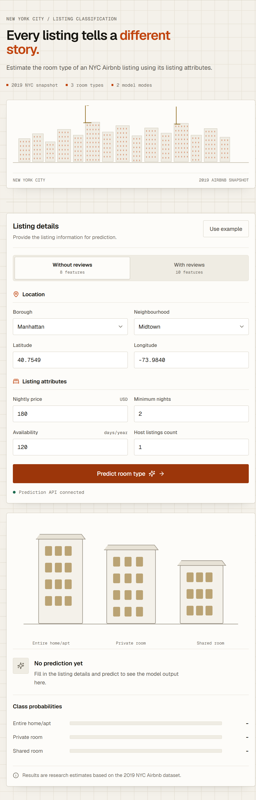
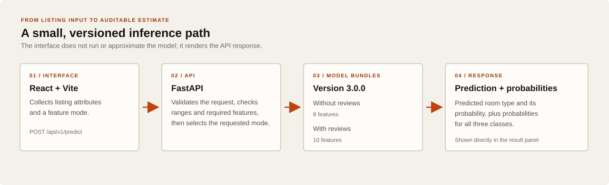
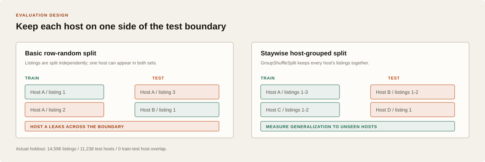

<div align="center">

# Staywise
### NYC Airbnb Room Type Predictor

**A full-stack machine-learning application for classifying NYC Airbnb listings.**

[](https://react.dev/)
[](https://vite.dev/)
[](https://fastapi.tiangolo.com/)
[](https://scikit-learn.org/)
[](ml/model_metadata.json)

*Every listing tells a different story.*

</div>

<p align="center">
  
</p>

<p align="center"><sub>Predictor interface screenshot captured from the running frontend.</sub></p>

---

## At a glance

Staywise takes listing attributes and estimates which of three room categories best describes an NYC Airbnb listing:

- **Entire home/apt**
- **Private room**
- **Shared room**

It combines a React interface, a FastAPI inference service, and two separately trained, versioned scikit-learn model bundles. The user chooses the feature mode based on whether review history is available. The API returns the predicted class and the probability assigned to each class; the interface visualizes that response.

> **Research scope:** the models were trained and evaluated using the 2019 NYC Airbnb listing snapshot. They classify records from that cross-sectional dataset. They are **not** validated forecasts of a listing's room type at its original creation date, current market conditions, booking demand, nightly price, or profitability.

## What the application does

| Capability | What it means |
|---|---|
| Two prediction modes | Select an 8-feature model without review history or a 10-feature model with review history. |
| Location-aware form | Choose a borough and a neighbourhood from the dataset's five boroughs and 221 neighbourhoods. |
| Validated API | FastAPI/Pydantic validates the mode and listing fields before inference. |
| Probability output | View the predicted class and all three class probabilities. |
| Model transparency | Inspect the recorded host-grouped holdout metrics and the limitations of each model. |
| Prediction animation | The building highlight follows the class returned by the API; the animation does not generate or modify predictions. |

## How a prediction travels through Staywise



1. A user enters listing details and chooses a feature mode.
2. React sends a JSON request to `POST /api/v1/predict`.
3. FastAPI validates the request with Pydantic and selects the matching model bundle.
4. The inference layer checks the feature contract and obtains the model's class probabilities.
5. FastAPI returns the predicted class, its probability, all class probabilities, the selected mode, and model version.
6. React renders the response. The building illumination is a visual representation of the returned class.

The model artifacts remain on the backend. The browser never loads a pickle or Joblib model directly.

## Dataset

The project uses the public **AB_NYC_2019.csv** dataset included in this repository.

| Dataset property | Value |
|---|---:|
| Rows | 48,895 listings |
| Original columns | 16 |
| Snapshot year | 2019 |
| Boroughs | 5 |
| Neighbourhoods | 221 |
| Target | `room_type` |

### Target distribution

| Room type | Listings | Share |
|---|---:|---:|
| Entire home/apt | 25,409 | 51.97% |
| Private room | 22,326 | 45.66% |
| Shared room | 1,160 | 2.37% |

The target is imbalanced: shared-room listings account for only about 2.4% of the dataset. This matters when evaluating the classifier. A model can achieve high overall accuracy while still missing many shared-room listings, so accuracy alone is not a sufficient performance measure.

## The two model modes

These are **two distinct fitted model bundles**, not one estimator with optional columns silently inserted.

### Without reviews — 8 features

Intended for a listing where review history is not supplied.

| Feature | Meaning |
|---|---|
| `neighbourhood_group` | NYC borough |
| `neighbourhood` | NYC neighbourhood |
| `latitude` | Listing latitude |
| `longitude` | Listing longitude |
| `price` | Nightly price in the dataset |
| `minimum_nights` | Minimum nights required |
| `availability_365` | Days available during the year |
| `calculated_host_listings_count` | Listings associated with the host |

### With reviews — 10 features

Uses the same eight fields plus:

| Additional feature | Meaning |
|---|---|
| `number_of_reviews` | Total review count |
| `reviews_per_month` | Average reviews per month |

When `number_of_reviews` is zero, `reviews_per_month` may be absent and is imputed as zero by the fitted pipeline. When review count is greater than zero, the API requires a review rate. The two modes are intentionally explicit so the application does not pretend review history exists when it is unavailable.

## Machine-learning concepts used

This section explains the actual modelling choices in the current v3 artifacts, and why they matter.

### 1. Host-grouped holdout — reducing host leakage

A simple random listing split can put one host's listings in both training and test sets. Because listings from the same host can share patterns, this can make evaluation look more optimistic than performance on unseen hosts.

Staywise uses `GroupShuffleSplit` with `host_id` as the group:

- 70% of host groups are assigned to training.
- 30% of host groups are assigned to the held-out test partition.
- The test partition contains 14,596 listings and 11,238 hosts.
- The number of hosts shared between training and test is **zero**.



This makes the holdout more demanding for a new-host scenario. It does not make the evaluation temporal: the dataset is still a 2019 snapshot. See the scikit-learn documentation for [group-based splitters](https://scikit-learn.org/stable/modules/cross_validation.html#cross-validation-iterators-for-grouped-data).

### 2. Preprocessing inside the model pipeline

Preprocessing is fitted as part of the scikit-learn pipeline, rather than being learned once from the full dataset before the split.

- **Numeric fields:** median imputation.
- **Categorical fields:** most-frequent imputation followed by one-hot encoding.
- **Review rate:** constant-zero imputation for the zero-review case.
- **Unseen category handling:** `OneHotEncoder(handle_unknown="ignore")` allows categories not seen during fitting to be handled without failing inference.

Keeping preprocessing inside the fitted pipeline helps prevent information from the held-out test data influencing imputation statistics or category encoding. The serialized model bundle carries the fitted preprocessing and estimator together.

Reference: [scikit-learn `ColumnTransformer`](https://scikit-learn.org/stable/modules/generated/sklearn.compose.ColumnTransformer.html) and [Pipeline](https://scikit-learn.org/stable/modules/generated/sklearn.pipeline.Pipeline.html).

### 3. HistGradientBoostingClassifier

The base classifier is `HistGradientBoostingClassifier` with balanced class weights. Gradient boosting builds an ensemble of decision trees sequentially: later trees work to reduce errors left by the current ensemble. The histogram-based implementation bins continuous features, which can make boosting more efficient on larger tabular datasets.

The current training recipe records:

- `max_iter=60`
- `learning_rate=0.08`
- `max_leaf_nodes=31`
- `l2_regularization=1.0`
- `class_weight="balanced"`
- `early_stopping=False`

**Class weighting** increases the training influence of less frequent classes. It is a way to account for imbalance during fitting; it does not guarantee strong minority-class recall. The shared-room result below makes that limitation visible.

Reference: [scikit-learn HistGradientBoostingClassifier](https://scikit-learn.org/stable/modules/generated/sklearn.ensemble.HistGradientBoostingClassifier.html).

### 4. Sigmoid probability calibration

A classifier's raw probability estimates are not automatically reliable confidence estimates. Calibration evaluates and adjusts how predicted probabilities correspond to observed outcomes.

The current bundles use `CalibratedClassifierCV` with sigmoid calibration and three `StratifiedGroupKFold` splits built from the training partition. Grouping by host is retained during calibration; the held-out test hosts are not used to fit the calibrators.

Calibration matters because the interface displays class probabilities, not just a label. It does not mean that every individual prediction is correct or that the probabilities are perfect. The recorded calibration diagnostics and Brier/log-loss metrics should be considered alongside classification scores.

References: [Probability calibration guide](https://scikit-learn.org/stable/modules/calibration.html) and [`CalibratedClassifierCV`](https://scikit-learn.org/stable/modules/generated/sklearn.calibration.CalibratedClassifierCV.html).

### 5. Evaluation metrics — why more than accuracy?

| Metric | What it tells us | Why it is included |
|---|---|---|
| Accuracy | Fraction of all predictions that are correct | Useful overall summary, but can hide minority-class errors. |
| Macro F1 | F1 calculated per class and averaged equally | Gives the small shared-room class equal weight in the aggregate. |
| Balanced accuracy | Average recall across classes | Helps reveal performance when class frequencies differ. |
| Precision | Of listings predicted as a class, how many truly belong to it? | Shows how often a class prediction is correct. |
| Recall | Of actual listings in a class, how many did the model find? | Especially important for the underrepresented shared-room class. |
| Brier score | Mean squared error of probability predictions (multiclass form) | Evaluates probability quality; lower is better. |
| Log loss | Penalizes probability assigned to the true class, especially confident errors | Evaluates the full probability distribution; lower is better. |
| Top-label ECE | Difference between confidence and accuracy across confidence bins | A diagnostic for top-class calibration; lower is better. |

Reference: [scikit-learn classification metrics](https://scikit-learn.org/stable/api/sklearn.metrics.html).

## Held-out model results

Both scenarios were evaluated on the same host-grouped 30% holdout. Values below are from `ml/model_metadata.json` and `ml/research/heldout_metrics.csv`.

| Metric | Without reviews | With reviews |
|---|---:|---:|
| Accuracy | **85.22%** | **85.59%** |
| Macro F1 | 70.28% | 70.38% |
| Balanced accuracy | 67.08% | 67.36% |
| Shared-room precision | **61.74%** | 59.35% |
| Shared-room recall | **28.84%** | **28.84%** |
| Shared-room F1 | 39.32% | 38.82% |
| Multiclass Brier score | 0.2264 | 0.2229 |
| Log loss | 0.3968 | 0.3905 |
| Top-label ECE | 0.0394 | 0.0417 |

### How to interpret this honestly

The with-reviews model has slightly higher accuracy and macro F1 on this holdout, but its shared-room precision and F1 are lower; shared-room recall is identical. It is therefore **not uniformly better**. Both models miss a substantial proportion of actual shared-room listings: recall of 28.84% means that roughly 71 out of every 100 shared-room examples in this test partition were not identified as shared rooms.

These are results on one host-grouped holdout, not proof of generalization to a later year, another city, or current Airbnb inventory. The model should not be described as production-validated.

## Training and evaluation flow


The model-development scripts and validation outputs are retained in `ml/research/`. In particular, `nested_validation.py` is supplied as a next-step model-selection workflow; **nested grouped cross-validation and expanded model-family/hyperparameter selection have not been completed**. The presence of a script is not evidence that the analysis has been run or passed.

## API contract

| Method | Endpoint | Purpose |
|---|---|---|
| `GET` | `/api/v1/health` | Service and model readiness |
| `GET` | `/api/v1/models` | Available model modes and versions |
| `POST` | `/api/v1/predict` | Validate a listing and return a prediction |

Example request:

```json
{
  "mode": "without_reviews",
  "listing": {
    "neighbourhood_group": "Manhattan",
    "neighbourhood": "Midtown",
    "latitude": 40.7549,
    "longitude": -73.9840,
    "price": 180,
    "minimum_nights": 2,
    "availability_365": 120,
    "calculated_host_listings_count": 1
  }
}
```

The response contains `predicted_room_type`, `predicted_class_probability`, `probabilities`, `mode`, `model_version`, and a research-scope disclaimer. The exact schemas are in `backend/app/schemas/prediction.py`.

## Run locally

### Requirements

- Python **3.13.x** (the serialized model environment is recorded in `ml/model_metadata.json`).
- Node.js and npm compatible with the Vite project.
- The pinned Python dependencies in `backend/requirements.txt`.

### 1. Start the FastAPI backend

**Windows PowerShell**

```powershell
cd backend
py -3.13 -m venv .venv
.\.venv\Scripts\Activate.ps1
python -m pip install --upgrade pip
python -m pip install -r requirements.txt
python -m uvicorn app.main:app --reload --host 127.0.0.1 --port 8000
```

**WSL / Linux / macOS**

```bash
cd backend
python3.13 -m venv .venv
source .venv/bin/activate
python -m pip install --upgrade pip
python -m pip install -r requirements.txt
python -m uvicorn app.main:app --reload --host 127.0.0.1 --port 8000
```

Check readiness at <http://127.0.0.1:8000/api/v1/health> and open interactive API docs at <http://127.0.0.1:8000/docs>.

### 2. Start the React frontend

Open a second terminal:

```bash
cd frontend
npm install
npm run dev
```

Open <http://localhost:5173>.

If the API is running on a different address, create `frontend/.env` from `frontend/.env.example` and set:

```env
VITE_API_BASE_URL=http://127.0.0.1:8000
```

### 3. Run checks

Backend tests:

```bash
cd backend
pytest -q
```

Frontend type-check and production build:

```bash
cd frontend
npm run build
```

## Repository structure

```text
nyc-airbnb-predictor/
├── backend/
│   ├── app/
│   │   ├── api/              # Versioned HTTP endpoints
│   │   ├── core/             # Application configuration
│   │   ├── ml/               # Input validation and inference
│   │   ├── schemas/          # Pydantic request/response schemas
│   │   └── services/         # Model registry and prediction service
│   ├── tests/                # API tests
│   └── requirements.txt
├── data/
│   └── AB_NYC_2019.csv
├── docs/
│   ├── architecture.md
│   └── assets/               # README screenshot and diagrams
├── frontend/
│   └── src/                  # React UI, styles and dataset-derived options
├── ml/
│   ├── artifacts/            # Runtime v3 Joblib bundles
│   ├── research/              # Training, metrics, calibration and monitoring
│   ├── source_artifacts/      # Preserved uploaded standalone estimator
│   └── model_metadata.json
└── notebooks/                 # Original exploration and model development
```

## Model artifacts and safety

The API loads the trusted, versioned v3 bundles from `ml/artifacts/`. Each bundle contains the fitted estimator, feature order, class order, input constraints, training-data identity, model version, and inference metadata. The separately uploaded `ml/source_artifacts/airbnb_room_type_with_reviews.pkl` is preserved for provenance; it is **not** the runtime model loaded by FastAPI.

Only load Joblib or pickle files from sources you trust. These formats can execute code during deserialization. Keep the Python and scikit-learn versions aligned with the serialized environment.

## Limitations and remaining validation work

The following gates remain open and are explicitly recorded in `ml/model_metadata.json` and `ml/research/validation_status.json`:

- **Nested grouped validation:** broader model-family and hyperparameter selection has not been completed.
- **Temporal / external validation:** no newer independent labelled NYC snapshot is included or scored.
- **Point-in-time feature availability:** the 2019 cross-sectional dataset does not establish when every predictor became available. The model is not validated as a listing-creation-time forecast.
- **Minority-class performance:** shared-room recall is 28.84%; product acceptance criteria and further training-only threshold/imbalance analysis are still needed.
- **Operational monitoring:** utilities and a policy are supplied, but live telemetry, delayed labels, alerting, and a model registry are not integrated.

Staywise is a research and demonstration application. Do not use its predictions as a guarantee or as the sole basis for a consequential decision.

## Further reading

The project uses the following scikit-learn concepts. These official references explain the underlying APIs and methods:

- [Group-aware cross-validation](https://scikit-learn.org/stable/modules/cross_validation.html#cross-validation-iterators-for-grouped-data)
- [ColumnTransformer](https://scikit-learn.org/stable/modules/generated/sklearn.compose.ColumnTransformer.html)
- [HistGradientBoostingClassifier](https://scikit-learn.org/stable/modules/generated/sklearn.ensemble.HistGradientBoostingClassifier.html)
- [Probability calibration](https://scikit-learn.org/stable/modules/calibration.html)
- [CalibratedClassifierCV](https://scikit-learn.org/stable/modules/generated/sklearn.calibration.CalibratedClassifierCV.html)
- [Classification metrics](https://scikit-learn.org/stable/api/sklearn.metrics.html)

---

<div align="center">

**Staywise** · NYC Airbnb Room Type Predictor · Model v3.0.0

*Built to make model outputs understandable — and model limitations visible.*

</div>
