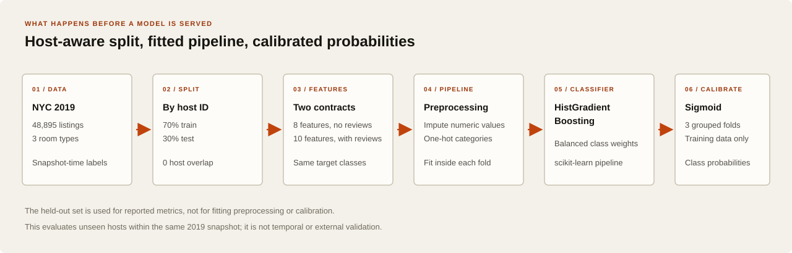
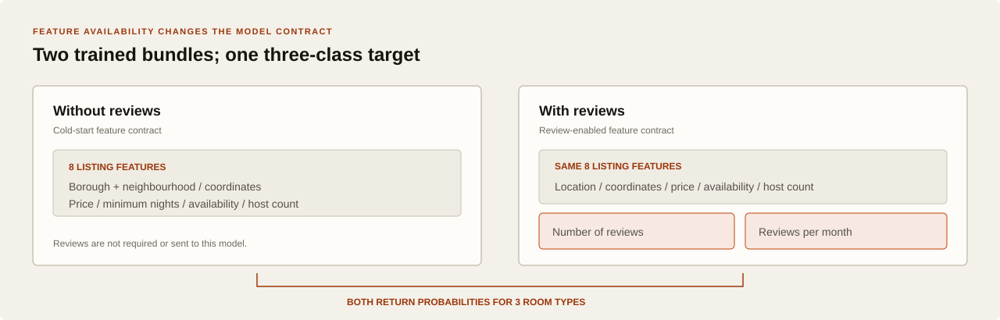

# Staywise — NYC Airbnb Room Type Predictor

**A research-grade, full-stack demonstration of room-type classification for NYC Airbnb listings.**

Staywise pairs a React predictor with a FastAPI service and two versioned scikit-learn model bundles. Choose whether review history is available, submit listing attributes, and inspect the predicted room type alongside probabilities for all three classes.

> **Scope:** estimates classify listings from the 2019 NYC snapshot. They are not guarantees, current-market predictions, or validated forecasts of a listing's room type at creation.

## What happens to a prediction?


The browser sends the entered attributes and selected feature mode to FastAPI. The API validates the input, selects the corresponding versioned model, and returns a prediction with class probabilities. The interface displays that response; it does not calculate or alter model outputs.

## The machine-learning approach

Both candidates use a scikit-learn pipeline with:

1. **A host-grouped holdout:** a 70/30 `GroupShuffleSplit` by `host_id`, leaving zero hosts shared between training and test.
2. **Fold-fitted preprocessing:** median imputation for numeric fields, most-frequent imputation and one-hot encoding for categorical fields. Missing review rate is imputed as zero in the review-enabled scenario.
3. **A class-weighted estimator:** `HistGradientBoostingClassifier` with balanced class weights.
4. **Sigmoid probability calibration:** three stratified, host-grouped folds built from training rows only.



### Two feature contracts

The modes are separate model bundles trained with different feature sets, not one model with review fields silently filled in.

| Mode | Features | Intended use |
|---|---:|---|
| Without reviews | 8 | Estimate from location, price, availability, stay length, and host listing count |
| With reviews | 10 | Use the same listing attributes plus review count and reviews per month |



## How is this different from a basic listing classifier?

The distinction is primarily in the **evaluation and serving contract**, not a claim that this model beats every alternative.

| A simpler implementation may... | Staywise instead... | Why it matters |
|---|---|---|
| Uses a row-random split | Keeps all listings from a host on one side of the holdout | Reduces the risk that familiar hosts inflate test performance |
| Reports accuracy alone | Reports macro F1, balanced accuracy, per-class results, and probability metrics | Makes minority-class and confidence behavior more visible |
| Returns only a class label | Returns the selected class and probabilities for every room type | Lets the interface show uncertainty rather than imply certainty |
| Uses one fixed feature set | Ships separate 8- and 10-feature bundles | Supports cases where review history is unavailable |
| Leaves preprocessing implicit | Stores preprocessing, estimator, class order, and feature contract in each versioned artifact | Keeps training and inference requirements explicit |

The evaluation diagram shows why the split differs from a row-random split:


**No completed benchmark establishes superiority over Random Forest, logistic regression, or other model families.** A nested grouped comparison is provided in [`ml/research/nested_validation.py`](ml/research/nested_validation.py), but that selection work has not been completed. Do not interpret the design choices above as evidence of state-of-the-art performance.

## Held-out results

Results below use the same host-disjoint 30% holdout (14,596 listings, 11,238 test hosts). Percentages are rounded from [`ml/research/heldout_metrics.csv`](ml/research/heldout_metrics.csv).

| Metric | Without reviews | With reviews |
|---|---:|---:|
| Accuracy | 85.2% | 85.6% |
| Macro F1 | 70.3% | 70.4% |
| Balanced accuracy | 67.1% | 67.4% |
| Shared-room precision | 61.7% | 59.4% |
| **Shared-room recall** | **28.8%** | **28.8%** |

The review-enabled model has slightly higher aggregate accuracy on this holdout, but lower shared-room precision and the same shared-room recall. It is not uniformly better. Shared rooms are a minority class, and the current recall remains a significant limitation.

## Run locally

### Backend

Use Python 3.13 and the pinned model-compatible versions in `backend/requirements.txt`.

**Windows PowerShell**

```powershell
cd backend
py -3.13 -m venv .venv
.\.venv\Scripts\Activate.ps1
python -m pip install --upgrade pip
python -m pip install -r requirements.txt
python -m uvicorn app.main:app --reload --host 127.0.0.1 --port 8000
```

**macOS, Linux, or WSL**

```bash
cd backend
python3.13 -m venv .venv
source .venv/bin/activate
python -m pip install --upgrade pip
python -m pip install -r requirements.txt
python -m uvicorn app.main:app --reload --host 127.0.0.1 --port 8000
```

API health: <http://127.0.0.1:8000/api/v1/health>

Interactive API docs: <http://127.0.0.1:8000/docs>

### Frontend

Open a second terminal. Install frontend packages from `frontend/` (there is no root `package.json`):

```bash
cd frontend
npm install
npm run dev
```

Open <http://localhost:5173>. The default API URL is `http://127.0.0.1:8000`; override it in `frontend/.env` with `VITE_API_BASE_URL` if needed.

## API

- `GET /api/v1/health` — service and model readiness
- `GET /api/v1/models` — loaded model versions and feature modes
- `POST /api/v1/predict` — prediction and class probabilities

The prediction request selects `without_reviews` or `with_reviews` and supplies the corresponding listing fields. Invalid fields and out-of-range values are rejected by the API.

## Tests and build

```bash
cd backend
pytest -q
```

```bash
cd frontend
npm run build
```

## Repository map

```text
backend/             FastAPI application and API tests
data/                NYC Airbnb 2019 snapshot
frontend/            React + Vite application
ml/artifacts/        Versioned inference bundles used by the API
ml/research/         Training, evaluation, and monitoring utilities
ml/source_artifacts/ Preserved source model artifact
notebooks/           Original exploration and model-development notebooks
docs/assets/         README diagrams
```

The API uses the versioned v3 bundles in `ml/artifacts/`. The standalone pickle in `ml/source_artifacts/` is retained for provenance; it is not loaded by the API. Only load trusted Joblib artifacts.

## Limitations and open validation work

- The data is a **2019 cross-sectional snapshot**. Host-grouped holdout results are not temporal or external validation.
- The snapshot does not establish which features were available at original listing creation; the model is not validated as a listing-creation forecast.
- Nested grouped model-family and hyperparameter selection is incomplete.
- Shared-room recall is about 28.8%; no product acceptance threshold has been defined.
- Monitoring utilities and policy exist, but are not connected to live traffic, delayed labels, alerting, or a model registry.

See [`ml/model_metadata.json`](ml/model_metadata.json) and [`ml/research/validation_status.json`](ml/research/validation_status.json) for the recorded metrics and validation status. This project is a research application, not a production-approved decision system.
